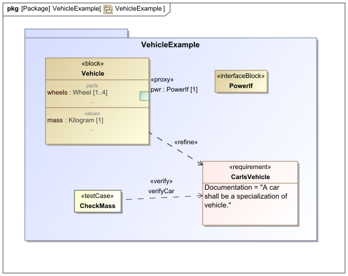
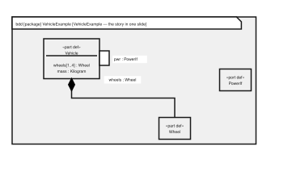

<!-- _class: lead -->

# Extending SysML v1 Models into SysML v2

## A practical path from deployed Cameo models to a standards-based ecosystem

**umlmeta + sysmlpy** — OMG-normative, stdlib-Python, validated end to end

*October 28 SysML v2 Exchange, INCOSE*

*Dr. Jon R. Fox — Georgia Tech Research Institute*

---

## About the presenter

**Dr. Jon R. Fox** is Division Chief Scientist of the Architecture and System Development Division in the Georgia Tech Research Institute (GTRI) Applied Systems Laboratory in Huntsville, Alabama.

- Applied physicist with 25 years of post-doctoral experience
- GTRI Technical Lead for FLRAA architectural risk reduction
- Open-source developer of **sysmlpy**, **umlmeta**, and **sysml_canvas**; curator of the **awesome-sysml** list
- INCOSE Certified Systems Engineering Professional (CSEP)
- Python, golang, Java, Groovy, C, C++, Fortran 

[github.com/mycr0ft](https://github.com/mycr0ft)

---

## What this talk will do

A practical look at how to build on existing modeling investments while
preparing for SysML v2:

1. **Start where programs are** — deployed SysML v1 and MagicDraw/Cameo models
2. **Extract and transform** them against normative OMG material
3. **Validate** the resulting SysML v2 with an independent reader
4. **Use** the textual model for analysis, views, automation, and downstream artifacts
5. **Preserve configuration discipline** — version control, identity, diffs, and reviewable evidence

The emphasis is not a promise of a one-click migration. It is a practical, inspectable path that preserves engineering intent and makes gaps visible.

---

## The migration problem

- Organizations have substantial engineering investment in deployed **SysML v1 and Cameo models**
- SysML v2 is **not** a profile bump — it is a new language (KerML + SysML) with a new metamodel, notation, and interchange
- Replacing a model base is neither practical nor desirable
- OMG provides a normative starting point: **SysML v2 Part 2 — *SysML v1 to SysML v2 Transformation***
- The transformation specification is now published with the formal SysML 2.0 release and maintained in the [SysML v2 Release repository](https://github.com/Systems-Modeling/SysML-v2-Release)
- The practical question for this opening session: **how can programs prepare for SysML v2 without abandoning what they already have?**

---

<!-- _class: compact -->

## The deployed Cameo artifact



*Original MagicDraw/Cameo rendering of the deployed SysML v1 model — a starting point for extraction and transformation.* This toolsuite ingests xmi and mdzip.

---

<!-- _class: two-col -->

## The model and its generated view

<div class="columns">
<div>

```sysml
package VehicleExample {
  part def Vehicle {
    part wheels[1..4] : Wheel;
    attribute mass : Kilogram;
    port pwr : PowerIf;
  }
  requirement <'R-1'> CarIsVehicle {
    doc /* A car shall be a specialization of vehicle. */
  }
  verification def CheckMass {
    objective obj_CheckMass { verify CarIsVehicle; }
  }
}
```

Every line was **emitted by the toolchain** and parsed by the authoritative v2 reader — no hand-tuning.

</div>
<div>



*Generated from model semantics — not hand-redrawn from the original Cameo diagram.*

</div>
</div>

*One source model: textual SysML v2 for interchange, plus a derived view for review and communication.*

---

## The conformance chain (R1 → R3 → R2)

| | OMG clause | Our artifact |
|---|---|---|
| **R1** | read a SysML v1 model representation | `umlmeta.xmi21` + `umlmeta.mdzip_import` → UML 2.5.1 objects |
| **R3** | transform v1 abstract syntax → v2 abstract syntax | `umlmeta.v1_to_v2` (textual) + AS transformation support |
| **R2** | SysML v2 abstract-syntax representation | `umlmeta.sysml2` — generated from the OMG normative CMOF XMI |

One chain: **file → R1 objects → transformer → R2 AS graph → textual notation → validated**

---

<!-- _class: compact -->

## How sysmlpy and umlmeta got here

- **sysmlpy** began as a fork of `sysml2py`; in 2026 it moved from the textX parser to an ANTLR4 grammar, adopted `pint`, and grew into a complete SysML v2 parser, analyzer, renderer, and round-trip toolchain.
- **umlmeta** began as `uml2py`, a clean-room UML/SysML metamodel project. It was renamed when the repository and package were published because the `uml2py` PyPI name was already occupied by an unrelated project.
- Today the projects are complementary: **umlmeta** reads and transforms SysML v1/UML representations and writes interchange artifacts; **sysmlpy** parses and validates SysML v2 text and provides downstream analyses and views.
- Why Python? Because large language reasoning models are all adept at Python. 

The names in this deck follow the current project identities:
`github.com/mycr0ft/umlmeta` and `github.com/mycr0ft/sysmlpy`.


---

<!-- _class: compact -->

## Why agentic AI needs a SysML v2 checker

Coding agents and LLMs are useful collaborators — and frequent sources of **plausible half-truths**:

- syntax that looks like SysML v2 but does not parse;
- valid-looking names and relationships with no resolvable semantics;
- invented features copied from SysML v1, UML, or another modeling language;
- requirements that appear in the model but have no satisfy or verify path.

That became a practical motivation for `sysmlpy`: give an agent a callable, standards-aware way to check its own work instead of asking another LLM whether the output looks right.

---

<!-- _class: compact -->

## Agent feedback is executable

```bash
sysmlpy parse candidate.sysml       # syntax gate
sysmlpy analyze candidate.sysml     # semantic findings
sysmlpy trace candidate.sysml       # requirement coverage
sysmlpy ci candidate.sysml          # automation / exit status
```

The checker is not a substitute for engineering judgment or an independent certification authority. It is a feedback loop: **generate → parse → analyze → revise**, with diagnostics that can be returned directly to the agent.

---

## Clean-room discipline

- Written from **normative OMG text only**:
  UML 2.5.1 XMI, SysML profile XMI, BPMN20.cmof, and the SysML v2 CMOF
- Historical calibration began against the 2025-04 transformation document; current work tracks the formal Part 2 and its [change history](https://github.com/Systems-Modeling/SysML-v2-Release/blob/2026-09/doc/changes/2b-SysML_v1_to_v2_Transformation_changes.pdf)
- No vendor tooling, no leaked spec text, no copied grammars
- **The honesty rule**: an element with no normative mapping **raises `UnmappedFeature` naming the v1 metaclass**
  — the toolchain refuses to guess

```python
raise UnmappedFeature(
    "v1 ProxyPort has no normative mapping (7.8.7 Table 30; SYSML2_-329)")
```

---

## R1: reading v1 as it actually exists

Two input dialects, one engine:

- **XMI 2.1 / EMF instance files** — OMG-published corpora
  (DoDAFLibrary.xmi, MeasurementsLibrary.xmi)
- **MagicDraw/Cameo `.mdzip`** — zip of XML snapshots with 15 years of
  dialect archaeology

```text
.mdzip → scrape → merge delta snapshots (keep-last dedup)
       → retag NoMagic's XMI-2.0/xsi spellings
       → inject xmi:type (metamodel-as-map coercion)
       → scrub cross-project refs to synthetic markers
       → read_xmi21 → gen.uml25 objects
```

12/12 files in the stress corpus (2015-era → 2024x-era) import without hand-holding.

---

<!-- _class: compact -->

## R3: the transformation mappings

Every mapping is anchored to the published document:

| SysML v1 | SysML v2 | Anchor |
|---|---|---|
| Block | PartDefinition | 7.8.4.3.3 |
| Property (composite, block-typed) | PartUsage | 7.8.4.3.13 |
| ValueType | AttributeDefinition | 7.8.4.3.14 |
| ConstraintBlock | ConstraintDefinition | 7.8.5.3.1 |
| Connector | ConnectionUsage | 7.7.12.2.14 |
| BindingConnector | BindingConnectorAsUsage | 7.8.4.3.2 |
| Requirement | RequirementUsage | 7.8.8.3.30 |
| DeriveReqt | Derivation connection | 7.8.8.3.15 |
| TestCase / Verify | VerificationCaseDefinition + verification membership | 7.8.8.3.26/.49 |

…25+ more initializer mappings, plus activity/state/instance internals.

---

## Honesty has teeth: spec gaps surface, not vanish

```sysml
part def Controller {
  part fullPort : MotorIf {@PortData {isFullPort = true;}}
  port proxyPort;
  /* v1 ProxyPort has no normative mapping (7.8.7 Table 30; SYSML2_-329) */
  out attribute torque : Kilogram;
  in flowIn;
  inout ref occurrence flowRef : Axle;
}
```

- FullPort → PartUsage **annotated with PortData metadata** (7.8.7.3.7/.15)
- ProxyPort → base Port mapping + **explicit not-mapped comment**
  (Table 30 lists no target; issue SYSML2_-329)
- Elisions are *comments in the model*, not silent drops

---

<!-- _class: compact -->

## A reviewed local rule can resolve the gap

The transformer exposes a **case-by-case mapping hook**. A project can accept one reviewed proxy port without pretending that the published transformation has a normative mapping for all proxy ports:

```python
from umlmeta import sysml as S

def local_rule(element, indent):
    if not isinstance(element, S.ProxyPort):
        return None                 # use the normative built-in rule
    name = element.name or "proxyPort"
    typ = element.type.name if element.type else None
    return [f"port {name}" + (f" : {typ}" if typ else "") + ";",
            f"/* reviewed local rule: ProxyPort {name} */"]

text = emit_v2(package, mapping_rule=local_rule)
```

`None` delegates to the built-in mapping; a rule may instead raise `UnmappedFeature` to require review. This is a **project decision**, not a new OMG mapping.

```sysml
port pwr : PowerIf;  /* reviewed local rule */
```

---

## R2: the SysML v2 abstract syntax

- Generated from the **OMG normative CMOF XMI**: 175 classes
  (82 KerML + 93 SysML), 319 associations, 623 OCL constraints carried as
  metadata
- Runtime wiring is the normative ownership machinery:
  - `OwningMembership` — containment (KerML §7.3.2.3)
  - `FeatureMembership` — features of a Type (featuringType)
  - `FeatureTyping` — feature typing
  - `Subclassification` — specialization
- Derived unions (`ownedElement`, `feature`) computed live

---

## Validation: sysmlpy is the oracle

Every emitted textual form is parsed by [sysmlpy](https://github.com/mycr0ft/sysmlpy) — the open-source SysML v2 reader — before it is considered done.

```
sysmlpy counts: {'package': 1, 'part': 5, 'attribute': 1,
 'enumeration': 1, 'port': 1, 'item': 1, 'state': 1, 'action': 1,
 'use_case': 2, 'requirement': 2, 'connection': 2, 'verification': 1,
 'metadata': 1, 'dependency': 3, 'allocation': 1}
```

Two independent implementations agreeing = the mapping is real, not a dialect accident.

---

## Parity: two pipelines, one answer

The same v1 model through both paths:

```text
v1 model ──> textual emitter (umlmeta.v1_to_v2) ──> SysML v2 text ─┐
                                                                   ├─> identical
v1 model ──> AS transformer                     ──> R2 AS graph   ─┘
```

The AS graph renders to **byte-identical notation** with the textual pipeline — checked, not hoped for.

**551 checks across 19 suites, all green (v0.2.0).**

---

## Proof on a real OMG corpus

`DoDAFLibrary.xmi` (the OMG-published UPDM example) end to end:

```sysml
package <'DoDAF Class Library'> {
  /* v1 stereotype applied: StandardProfileL2::ModelLibrary */
  attribute def SecurityAttributes {
    doc /* W3C XML Schema for the Intelligence Community Metadata
           Standard for Information Security Marking (IC-ISM) */
    attribute classification : ClassificationType;
    attribute classifiedBy : String;
    ...
  }
}
```

V1 stereotypes surface as recorded applications — provenance travels with the model.

---

## Beyond transformation: utilization

The same metamodel layer powers a full write path:

- **XMI 2.1/EMF instance writer** — round-trips both OMG dialects with canonical structural parity
- **CMOF + EMOF metamodel writers** — reconstructs OMG `BPMN20.cmof`
- **Stereotype & profile-application writing** — both UML 2.1 and 2.5.1-era dialects
- **Normative derivations** (`derived.py`) — owners, qualified names, generalization closures, with spec OCL anchors

---

## Analysis and traceability on the transformed model

The emitted text is immediately queryable — no re-modeling step:

```bash
sysmlpy trace vehicle_example_v2.sysml
```

```text
Requirement traceability: 2 requirements, 0 covered, 0 partial, 2 uncovered
- VehicleExample::CarIsVehicle [uncovered]
    text: A car shall be a specialization of vehicle.
    satisfied by: (none)
    verified by: (none)
```

The transformation faithfully reports that this legacy model has
**no verified requirements**. That is an engineering finding about the source
model, surfaced automatically — not a defect of the migration.

---

## Automated checking as a CI gate

```bash
sysmlpy ci vehicle_example_v2.sysml
```

```text
warning: semantic: REQUIREMENT_UNCOVERED: 'CarIsVehicle' has no satisfy/verify
warning: semantic: NAMING_CONVENTION: Usage 'CarIsVehicle' should be camelCase
warning: semantic: FILE_PACKAGE_MISMATCH: package 'VehicleExample' vs filename
summary: 0 parse failure(s), 0 semantic error(s), 5 semantic warning(s)
result: PASS
```

- **Parse failures block**; semantics are advisory by default
- Exit codes mean a model can be reviewed like source code
- This is the hinge: once the model is text with a gate, the whole software-engineering toolchain applies to it

---

<!-- _class: compact -->

## Simulation: a derived branch, not (yet) a round trip

A companion workflow (**FASSST**, GTRI IRAD) generates simulation input artifacts from SysML v2 models — four layers: parse, extract, map, generate.

| Target | Generated from public example models |
|---|---|
| AFSIM | 50 constellation platforms, 50 sensors |
| Gazebo | 5 robot / UAV models, 16 sensors |
| JSBSim | 2 aircraft configurations |

- Repeated generation from unchanged source → **identical bytes**
- Reducing orbital planes 5→4 → **40 platforms and a changed digest**
- The AFSIM artifact re-parsed by a Poliastro adapter recovered all 50 satellites with the tested orbital elements preserved

*Determinism, not semantic equivalence. FASSST is not open-sourced and the AFSIM work is release-gated — reported here as context, not demonstrated live.*

---

## Live Cameo integration

For organizations that keep the commercial tool, `cameo_sidecar` bridges Python and AI agents to a **live, open Cameo session** — no TWC admin needed:

```text
Python / agent ──HTTP 127.0.0.1 + token──▶ Groovy macro in Cameo ──▶ live model
```

- Localhost-only, token-authenticated; inherits the user's TWC session
- **Writes are opt-in twice over**; locking and commits are separately gated
- The honest cycle is **lock → edit → commit → unlock**, and every step lands in an audit log

This path **requires the commercial tool**, so it is an integration option — not a component of the open-only thread.

---

## Version control without the vendor

TeamworkCloud churns `xmi:id`s on every save. Two defenses:

- **Semantic diff** (`mdzip_diff.py`) — flatten to (metaclass, qualified-path, feature) records; ids discarded by construction; match by path → moved → similarity
- **Semantic content hash** — model content hash that is invariant across tool upgrades (verified on real profile libraries: zero delta for unchanged models)

Compare *models*, not serialization noise.

---

<!-- _class: compact -->

## The wider MBSE toolchain

| Tool | Role |
|---|---|
| **sysmlpy** | authoritative v2 reader/parser — the validation oracle |
| **SysML-v2-Release** | official OMG release (spec + libraries) |
| **SysON** (podman compose) | web-based v2 modeling, lives off the same `.sysml` text |
| **SysML v2 Jupyter container** | notebook-driven analysis of v2 models |
| **VS Code SysML extension** | grammar source for this deck's highlighting |
| **sysml-v2-lsp** | language-server editing experience |

All of them speak **textual SysML v2** — which is exactly what the transformation emits.

---

## Reproducible by construction

A digital thread that changes under re-execution cannot carry configuration evidence, so every stage is checked for determinism:

```text
write is deterministic (byte-identical)          PASS
Cameo write is deterministic (byte-identical)    PASS
emitted v2 == vehicle_example_v2.sysml           PASS  (byte-identical)
RESULT: 14 passed, 0 failed
```

Interchange export is content-addressed and idempotent:

```bash
sysmlpy export model.sysml --stable-ids
sysmlpy export model.sysml --reconcile-with model.json -o model.json
```

Measured for this deck: two `--stable-ids` runs produced an identical SHA-256, and re-exporting against the registry was a **fixed point**.

---

<!-- _class: compact -->

## Identity: surviving edits without a vendor database

The load-bearing mechanism for CM — three layers, each for a different consumer:

- **L1 qualified name** — `VehicleExample::Vehicle::wheels`; meaningful in review, *not* stable under rename
- **L2 stable identifier** — RFC 9562 v5 UUID over qualified name + element kind; content-addressed
- **L3 registry sidecar** — reconciles identifiers when an ancestor is renamed; an artifact under configuration control, not a server

Renaming one sibling `part def` in the 647-element export disturbed **5 of 647 identifiers**; the other 642 were preserved.

An ambiguous match is a **refusal**, not a heuristic merge — a silently merged identity is a corrupted configuration.

---

## A recipe you can run today

```bash
# 1. pull a v1 model out of a vendor tool
python mdzip_import.py project.mdzip        # or: xmi21 for .xmi

# 2. transform v1 -> v2
python -c "import v1_to_v2; print(v1_to_v2.emit_v2(model))"

# 3. validate with the authoritative reader
~/sysmlpy check   # emitted text parses; counts per element kind

# 4. hand the .sysml text to the v2 ecosystem
#    (SysON, Jupyter, LSP editors, sysmlpy analyses)
```

Diffs across revisions: `mdzip_diff.py before.mdzip after.mdzip`.

---

## What "conformant" buys you

- **Traceability**: every emitted form cites its normative anchor
- **Predictability**: unmapped constructs are loud, not lossy
- **Interoperability**: output parses in the authoritative reader and in SysON/LSP tooling
- **Idempotence**: regenerating from unchanged inputs changes nothing
- **Vendor independence**: the pipeline is stdlib Python + OMG documents

---

<!-- _class: dense -->

## Current limits (the honest slide)

**`umlmeta` — transformation / abstract syntax**

- AS transformer spans **waves A–S** — structural core, state machines (regions + transitions + triggers), activities (pins, object flows, guarded edges), requirements + the verification chain (verdict return, objective choreography, Refine/Trace), use cases + actors, ports/interfaces incl. conjugation and FullPort → PartUsage, imports, associations + **AS multiplicities**, InformationFlows, interactions, value-specification literals
- Documented elisions ride the file's realization table (association-end qualifiers/defaults, conjugated-port typing, use-case objectives, function synthesis/assignments, guard and object-flow tail forms); anything truly unmapped raises `UnmappedFeature`

**`sysmlpy` — SysML v2 reader / interchange**

- Interaction syntax is currently mapped by `umlmeta` but elided because the `sysmlpy` reader has no interaction element
- `allocation def` with redefined ends passed `parse` but failed `export` (≤ v0.97.1) — found through this project and **fixed upstream in v0.97.2**: the end-declaration redefinitions had been dropped on the dump side of the export reparse
- An upstream reader bug found by building the workflow in the open, not a transformation mapping gap

**Evidence boundary**

- Conformance suites here are **author-written against author-read specs**: they show the code matches my reading of OMG text, not independent certification

---

<!-- _class: compact -->

## The loop is not closed yet

The honest status of the "closed-loop digital thread":

| Direction | Status |
|---|---|
| v1 → v2 transformation | **demonstrated**, byte-identical, validated |
| v2 → analysis / trace / CI | **demonstrated** |
| v2 → simulation input | **demonstrated** (release-gated context) |
| simulation results → back into the model | **not implemented** |

What is deliberately *not* claimed: bidirectional transformation, result ingestion into SysML, automatic stale-result detection, or complete semantic fidelity.

The forward thread plus governed identity is the result. The return path is **designed, not built** — and saying so is the point of the next slide.

---

<!-- _class: lead -->

## Takeaways

1. **Normative transformation is implementable** — in the open, from OMG documents, with a validation oracle
2. **v1 models are not stranded** — XMI and .mdzip both feed the chain
3. **Textual SysML v2 is the interchange medium** for the whole v2 ecosystem — analysis, simulation, views, and CI all read it
4. **Identity and baselines are the CM story** — content-addressed ids and byte-derived evidence, no vendor database required
5. Honesty is a feature: `UnmappedFeature` > silent data loss, and an open gap list > an unverifiable conformance claim

*Repo: `github.com/mycr0ft/umlmeta` — reader, transformer, AS, writers, diff — open source.*

---

<!-- _class: compact -->

## Thank you — questions?

**The practical message:** existing SysML v1 and Cameo investments are a starting point, not a dead end. Extract what is deployed, transform what has a normative mapping, validate the result, and make every gap reviewable.

- Toolchain: **umlmeta** (metamodel/transformation) + **sysmlpy** (validation)
- Event: [October SysML v2 Exchange](https://www.incose.org/event/october-sysml-v2-exchange/)
- Spec anchor: OMG *SysML v2.0, Part 2 — SysML v1 to SysML v2 Transformation*
- Working release baseline: [SysML v2 Release, 2026-09](https://github.com/Systems-Modeling/SysML-v2-Release/tree/2026-09)
- Deck built with Marp + Shiki + the VS Code SysML v2 grammar
- Try it: `git clone https://github.com/mycr0ft/umlmeta && python3 check_xmi_vehicle.py`

**Related CSER27 papers in preparation:** an open, standards-anchored digital thread (SysML v2 + OSLC + AP242); and a deterministic SysML v2-to-simulation transformation workflow.
